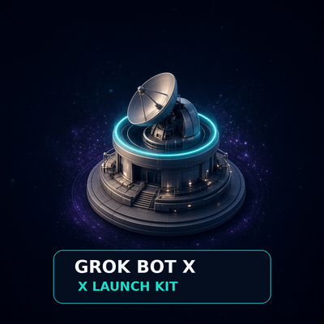

# Brand kit — "Signal Observatory"

**Story.** An observatory doesn't shout; it listens carefully, records what it sees, and only then reports. The kit works the same way: scan live signals → keep evidence → draft three options → a human approves. Every image shows that calm, instrument-grade reliability.

## Palette
| Role | Name | Hex |
|---|---|---|
| Background | Ink navy | `#050B1F` |
| Surface | Deep navy | `#0F1D3A` |
| Primary accent | Signal teal | `#22D3EE` |
| Secondary accent | Horizon blue | `#3B82F6` |
| Soft accent | Lavender | `#A78BFA` |
| Highlight / text on dark | Warm ivory | `#F5EFE3` |
| Muted text | Fog | `#9FB7D9` |

## Typography (system fonts)
- Headings: `Inter, "Segoe UI", Helvetica, Arial, sans-serif` — 700–800 weight, wide letter-spacing for small all-caps labels.
- Body: same stack, 400 weight, 15–16 px. Code: `ui-monospace, SFMono-Regular, Menlo, monospace`.
- Hierarchy: kicker (12–14 px caps, teal) → title → one-line explanation. Keep in-image text to the wordmark only.

## Layout rules
- Generous negative space; one focal object per image; observatory usually in the right third.
- Spacing on an 8 px grid; cards use 14 px radius with a thin teal edge.
- **Do:** glass panels, thin light threads, check-mark seals, orbit rings, constellation dots.
- **Don't:** coins, charts that look like trading, rocket/moon clichés, fake UI screenshots, X logos implying affiliation, garbled text, neon overload.

## Assets
| Asset | File | Size | Use |
|---|---|---|---|
| Hero (original) | `docs/brand/originals/hero.jpg` | 1280×720 | README banner, launch post image |
| Profile mark (original) | `docs/brand/originals/profile-mark.jpg` | 1024×1024 | Source for avatars |
| Profile 400 | `docs/brand/identity/profile-400.png` | 400×400 | X / GitHub avatar (center-cropped; circle-safe) |
| Profile 800 | `docs/brand/derived/profile-800.jpg` | 800×800 | High-DPI avatar |
| Banner (original) | `docs/brand/originals/banner.jpg` | 1280×720 | Slides, video end card (text-safe left 2/3) |
| X header | `docs/brand/derived/x-header-1500x500.jpg` | 1500×500 | X profile header (3:1 crop, ~1.17× Lanczos upscale; keep text out of the bottom-left avatar area) |
| GitHub social preview | `docs/brand/derived/github-social-1280x640.jpg` | 1280×640 | Repo Settings → Social preview (upload manually) |
| README hero | `docs/brand/derived/readme-hero-1280x720.jpg` | 1280×720 | README top image |
| Scenes ×6 | `docs/assets/scenes/*.jpg` | 1280×720 | research, evidence, drafts, approval, monitoring, getting-started |
| Fallback panels ×6 | `docs/assets/*.svg` | 1200×420 | Code-generated diagrams with example labels |

Regenerate derivatives with `python3 scripts/derive-brand.py` (Pillow). Exact prompts: [docs/brand/prompts.md](docs/brand/prompts.md).

## Creator identity variants

The canonical public starter assets remain generic and reusable. Creator-branded promotional exports live in `docs/brand/identity/`; use these for the creator's X/GitHub identity. They name **GrokBot X Launch Kit**, **Maliot100X**, **X Launch Traction · @CLAWRENAi**, and `github.com/Maliot100X/grokbot-x-launch-kit` with exact font-rendered text.

| Asset | Purpose |
|---|---|
| `identity/profile-400.png`, `identity/profile-800.jpg` | Creator-branded avatar variants |
| `identity/x-header-1500x500.jpg` | Creator-branded X profile header |
| `identity/branded-social-1280x720.jpg` | Creator-branded wide launch banner |
| `identity/observatory-background.jpg` | Text-free panoramic background for future variants |

The exact prompts and source reference used for the identity extension are recorded in `docs/brand/prompts.md`.
