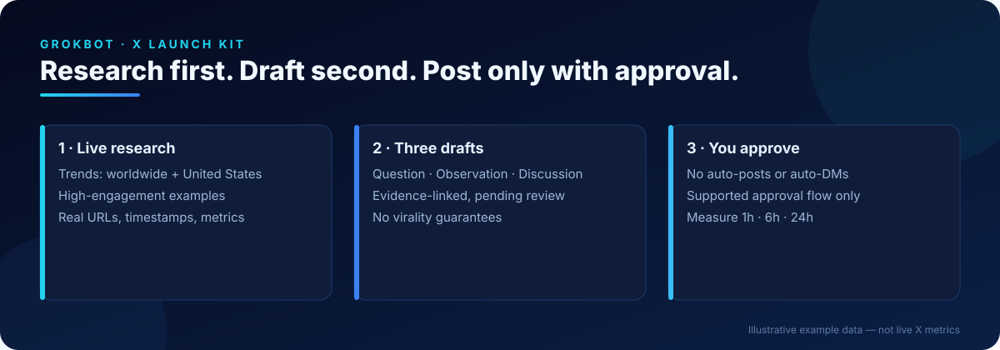
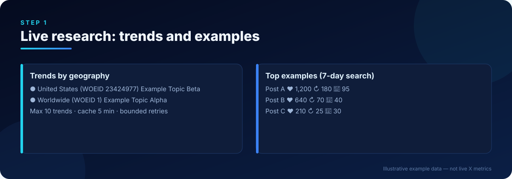
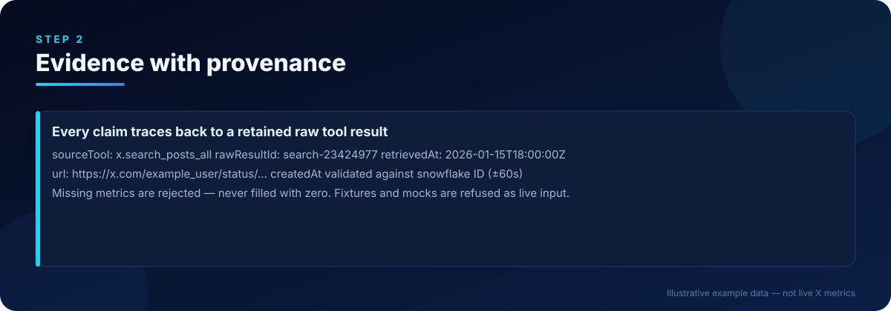
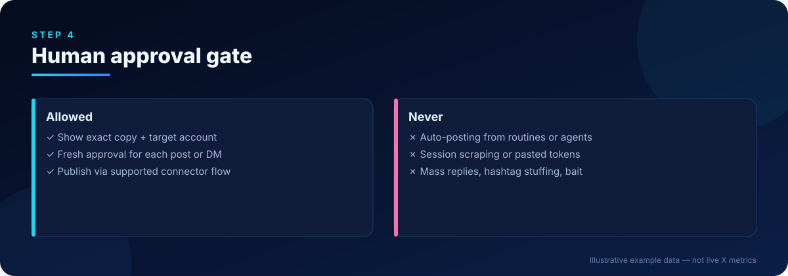
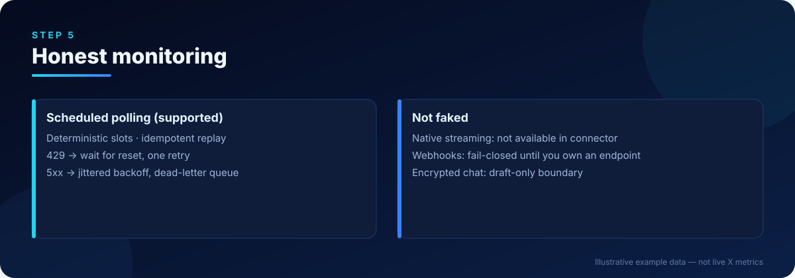

<p align="center"></p>

<h1 align="center">GrokBot X Launch Kit</h1>

<p align="center"><b>Research-first X launches for Grok Bot:</b> live trends, real engagement evidence, three review-gated drafts, safer monitoring, and reusable marketing workflows.</p>

<p align="center">
<a href="LICENSE"></a>


</p>

> **Turn any Grok Bot into a disciplined X launch researcher.** Every post starts from current US + worldwide trends and real high-engagement examples, becomes exactly three evidence-linked drafts, and goes out only after *you* approve it. No tokens pasted, no scraping, no fake "instant virality".

## Quick links
| | |
|---|---|
| 🚀 [Quickstart](#quickstart) | ⚙️ [Setup guide](docs/setup.md) |
| 🧠 [Skill](skills/live-x-research-and-post/SKILL.md) | 💬 [Copy-paste setup prompt](prompts/grok-bot-setup.md) |
| 🏗️ [Architecture](docs/architecture.md) | ✅ [Capabilities](docs/capabilities.md) |
| 📄 [Snapshot format](docs/snapshot-format.md) | 🔒 [Security](docs/security.md) |
| 🧾 [Evidence](docs/evidence.md) | 🤝 [Contributing](CONTRIBUTING.md) |

## Quickstart
```sh
git clone https://github.com/Maliot100X/grokbot-x-launch-kit.git
cd grokbot-x-launch-kit
npm ci
npm test && npm run typecheck && npm run build
npm run example          # fictional example snapshot -> 3 drafts per topic, deterministic replay
npm run demo             # synthetic fixture demo
bash scripts/verify.sh   # everything + SVG, link and secret checks
```

<details><summary><b>Prefer curl?</b> Inspect-first installer pinned to a tag (never pipe to bash blindly)</summary>

```sh
curl -fsSLo install.sh https://raw.githubusercontent.com/Maliot100X/grokbot-x-launch-kit/v1.0.0/scripts/install.sh
less install.sh     # read what it does
bash install.sh     # clones v1.0.0, prints the commit, asks before running setup
```
Or download the tagged archive: `https://github.com/Maliot100X/grokbot-x-launch-kit/archive/refs/tags/v1.0.0.tar.gz`
</details>

## Give it to your Grok Bot
1. Open [`prompts/grok-bot-setup.md`](prompts/grok-bot-setup.md) and paste the boxed prompt into your Grok Bot.
2. It saves the [`live-x-research-and-post`](skills/live-x-research-and-post/SKILL.md) skill, checks your X connector, and tells you what *you* still need to click.
3. Optional helper roles: [`prompts/agent.md`](prompts/agent.md) · persona: [`prompts/agent-profile.md`](prompts/agent-profile.md).

## How it works

### 1 · Live research


Your Grok Bot reads current trends (US WOEID 23424977, worldwide WOEID 1) and searches recent original posts with public metrics through its built-in X connector.

### 2 · Evidence with provenance


Those results become a [snapshot](docs/snapshot-format.md). The validator rejects fixtures, missing metrics, and ID/timestamp mismatches before anything is drafted.

### 3 · Three drafts + optional media


Exactly three distinct drafts per topic, each linked to evidence and marked `pending_review`.

### 4 · Approval gate


The code has **no** publish or DM methods. Posting happens only in the Grok Bot app after you approve the exact text.

### 5 · Honest monitoring


Deterministic slots, idempotent replay, bounded retries and a dead-letter queue. Polling is never presented as streaming.

## What does what
| | This repo (tested code) | Grok Bot X connector | Optional, user-installed |
|---|---|---|---|
| Fetch trends/posts | ❌ (you supply a snapshot) | ✅ | `xurl` with your own dev app |
| Validate + rank evidence | ✅ | — | — |
| Exactly 3 drafts per topic | ✅ | via skill | — |
| Publish / DM | ❌ never | ✅ with your approval | — |
| Images / video | — | ✅ native | Canva, Remotion |
| Deep research / monitoring | — | web search | Parallel, Firecrawl |

Full matrix: [docs/capabilities.md](docs/capabilities.md).

## Upstream references (linked, not copied)
- [`xai-org/x-algorithm`](https://github.com/xai-org/x-algorithm) — the open-sourced For You ranking code the skill's tactics are grounded in.
- [`coreyhaines31/marketingskills`](https://github.com/coreyhaines31/marketingskills) — marketing skill playbooks; review its license before reuse.
- [`xdevplatform/xurl`](https://github.com/xdevplatform/xurl) — official X API CLI (requires your own developer credentials).

`bash scripts/fetch-references.sh` clones the first two at pinned commits into a git-ignored `reference/` folder.

## Repository map
| Path | Contents |
|---|---|
| `src/`, `test/` | TypeScript pipeline and Node test suite |
| `skills/live-x-research-and-post/` | The reusable skill |
| `prompts/` | Setup prompt, agent profile, helper roles |
| `docs/` | Architecture, capabilities, setup, snapshot format, security, evidence, design spec |
| `docs/assets/` | Six coordinated SVG panels (`node scripts/gen-assets.mjs`) |
| `docs/examples/` | Fictional example snapshot |
| `docs/ci/` | GitHub Actions workflow to copy into `.github/workflows/` |
| `scripts/` | `setup.sh`, `verify.sh`, `install.sh`, `fetch-references.sh`, `check-repo.mjs` |

## Not included, on purpose
Private account data, live-run artifacts, credentials, bulk-copied third-party skills, session scraping, auto-posting/DMs, fake streaming or webhook crypto, and any promise of guaranteed views.

## License
[MIT](LICENSE) © 2026 X Launch Kit Contributors. Not affiliated with X Corp. or xAI.
