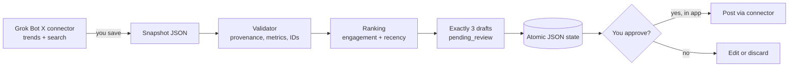
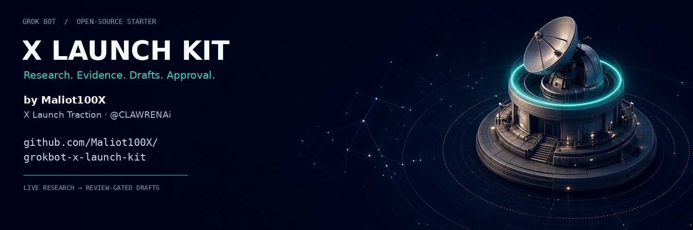

<p align="center"></p>

<h1 align="center">GrokBot X Launch Kit</h1>

<p align="center"><b>Research-first X launches for Grok Bot:</b> live trends, real engagement evidence, three review-gated drafts, safer monitoring, and reusable marketing workflows.</p>

<p align="center">
<a href="LICENSE"></a>


</p>

> [!IMPORTANT]
> **How this really works.** Your Grok Bot does the live reading through its built-in X connector. This repo's code does **not** connect to X: it takes a saved *snapshot* (a JSON file of what the bot read), checks it, ranks the evidence, and writes exactly three drafts per topic for you to review. Nothing here can post, reply, or DM.

## Contents
[Why](#why) · [Five-minute start](#five-minute-start) · [No-code setup](#no-code-setup-for-grok-bot-users) · [How it works](#how-it-works) · [Commands](#commands) · [Example evidence](#example-evidence-object) · [Architecture](#architecture) · [Testing](#testing-evidence) · [Failures](#when-things-fail) · [What's real](#whats-live-whats-scheduled-whats-not-available) · [Plugins](#optional-plugins-you-install-them) · [Brand kit](#brand-kit) · [Limits](#known-limits) · [FAQ](#faq) · [Contributing](#contributing)

## Why
Most "viral post" tools guess. This kit makes your bot **look first**: what is trending right now in the US and worldwide, which real posts on that topic got attention, and why. Only then does it write — three different options, each linked to the posts it learned from — and it waits for your yes.

## Five-minute start


You need [Node.js 22+](https://nodejs.org) and git.

```sh
git clone https://github.com/Maliot100X/grokbot-x-launch-kit.git
cd grokbot-x-launch-kit
bash scripts/setup.sh     # installs pinned dev deps, type-checks, runs tests
npm run example           # demo on FICTIONAL data: 3 drafts per topic + replay check
bash scripts/verify.sh    # everything + image, link and secret checks
```

<details><summary>Prefer curl? Use the inspect-first installer (never <code>curl | bash</code>)</summary>

```sh
curl -fsSLo install.sh https://raw.githubusercontent.com/Maliot100X/grokbot-x-launch-kit/v1.0.0/scripts/install.sh
less install.sh   # read it first
bash install.sh   # clones tag v1.0.0, prints the commit, asks before running setup
```
</details>
<br clear="right">

## No-code setup for Grok Bot users
Don't want a terminal? Paste this into your Grok Bot (full version: [`prompts/grok-bot-setup.md`](prompts/grok-bot-setup.md)):

```text
Set yourself up as my research-first X launch assistant using
https://github.com/Maliot100X/grokbot-x-launch-kit
Save skills/live-x-research-and-post/SKILL.md as a skill named live-x-research-and-post.
Use only your built-in X connector; never ask me for keys or passwords.
For every post: US + worldwide trends -> top original posts from the last 48h with real
URLs and metrics -> exactly three drafts with evidence -> show me -> post only if I approve.
Suggest optional plugins but let me install them. Never promise virality.
```

Helper roles for sub-agents: [`prompts/agent.md`](prompts/agent.md) · persona: [`prompts/agent-profile.md`](prompts/agent-profile.md) · skill: [`skills/live-x-research-and-post/SKILL.md`](skills/live-x-research-and-post/SKILL.md)

## How it works
<table>
<tr>
<td width="50%"><br><b>1 · Live research.</b> The bot reads trends for the United States (place ID 23424977) and worldwide (place ID 1), then searches recent original posts with their likes, reposts, replies and quotes.</td>
<td width="50%"><br><b>2 · Evidence with provenance.</b> Each post keeps where it came from: which tool, when, which query. The checker refuses made-up or incomplete data.</td>
</tr>
<tr>
<td><br><b>3 · Three drafts + media.</b> Exactly three options — a question, an observation, a discussion — each linked to the evidence. Media is optional (<a href="docs/media-workflows.md">media workflows</a>).</td>
<td><br><b>4 · You approve.</b> Drafts stay <code>pending_review</code>. Posting happens only in the Grok Bot app after you approve that exact text.</td>
</tr>
<tr>
<td><br><b>5 · Honest monitoring.</b> Checks run on a schedule (polling), with safe retries. It is never described as live streaming.</td>
<td>Prefer diagrams? Code-generated panels with example labels:<br><a href="docs/assets/research.svg">research</a> · <a href="docs/assets/evidence.svg">evidence</a> · <a href="docs/assets/drafts.svg">drafts</a> · <a href="docs/assets/approval.svg">approval</a> · <a href="docs/assets/monitoring.svg">monitoring</a> · <a href="docs/assets/hero.svg">overview</a></td>
</tr>
</table>

## Commands
| Command | What it does |
|---|---|
| `npm test` | Builds and runs the full test suite |
| `npm run typecheck` / `npm run build` | TypeScript check / compile to `dist/` |
| `npm run example` | Ingests the fictional [`snapshot.example.json`](docs/examples/snapshot.example.json) twice in a temp folder; prints 3 drafts per region and confirms replay gives identical IDs |
| `npm run demo` | Synthetic fixture run, state saved to `.data/fixture-state.json` |
| `npm run live:snapshot -- my-snapshot.json` | Ingests a snapshot your bot produced; output in git-ignored `.data/reviews/` |
| `bash scripts/verify.sh` | Tests + demos + image/link/secret checks |
| `bash scripts/fetch-references.sh` | Optional: clones official upstream repos at pinned commits into git-ignored `reference/` |

## Example evidence object
One post from the snapshot (**example data — fictional**; the full contract is in [`docs/snapshot-format.md`](docs/snapshot-format.md)):

```json
{
  "id": "2011803053061046276",
  "url": "https://x.com/example_user/status/2011803053061046276",
  "text": "EXAMPLE DATA (fictional post 1 about Example Topic Beta) — not a real X post.",
  "createdAt": "2026-01-15T14:10:00Z",
  "metrics": { "likes": 1200, "reposts": 180, "replies": 95, "quotes": 22 },
  "provenance": {
    "origin": "parent-supported-connector",
    "retrievedAt": "2026-01-15T18:00:00Z",
    "woeid": 23424977,
    "geography": "United States",
    "query": "\"Example Topic Beta\" lang:en -is:retweet",
    "sourceTool": "x.search_posts_all",
    "rawResultId": "search-23424977",
    "parameters": { "query": "\"Example Topic Beta\" lang:en -is:retweet", "start_time": "2026-01-08T18:00:00Z" }
  }
}
```

The post ID's built-in timestamp must match `createdAt` (within 60 s), and the same numbers must appear in the stored raw tool result, or the snapshot is rejected.

### Replay and the three drafts, in code
```js
import { readSnapshotFile, ingestLiveSnapshot } from './dist/snapshot.js';
const input = await readSnapshotFile('docs/examples/snapshot.example.json');
const opts = { now: new Date('2026-01-15T19:00:00Z'), reviewRoot: '.data/reviews-demo' };
const first = await ingestLiveSnapshot(input, opts);
const again = await ingestLiveSnapshot(input, opts);   // same input + same slot = same drafts
console.log(first.results.map(r => r.drafts.length));   // [3, 3]
console.log(again.results.every(r => r.replayed));      // true
```
Example output draft: *"What is your biggest open question about Example Topic Beta? Looking for perspectives, not predictions."* (`status: pending_review`)

## Architecture

Module-by-module: [`docs/architecture.md`](docs/architecture.md).

## Testing evidence
Verified on a fresh checkout for this release: **44/44 tests passing**, type-check and build clean, example demo gives 3 drafts per region with identical IDs on replay, and repository checks pass (SVG structure, image dimensions and size budget, local links, secret patterns). The GitHub Actions workflow is provided at [`docs/ci/ci.yml`](docs/ci/ci.yml) — copy it into `.github/workflows/` to enable CI. More: [`docs/evidence.md`](docs/evidence.md).

## When things fail
| Situation | What happens | What you do |
|---|---|---|
| Rate limited (HTTP 429) | Waits until the reset time, retries once | Nothing; or slow your schedule |
| Server errors (5xx) | Short random back-off, a few bounded retries, then a dead-letter record | Check status later; rerun the same slot |
| Snapshot missing metrics, timestamps, or raw results | Rejected — **no files written** | Ask your bot to re-read with the needed fields |
| Same snapshot run twice | Replay: identical drafts, no duplicates | Nothing |
| Stale trends or two failures in a row | The skill reports "degraded" instead of guessing | Retry later |

## What's live, what's scheduled, what's not available
| | Status |
|---|---|
| Trends + post search through the Grok Bot X connector | ✅ Live reads, done by your bot |
| Posting / DMs through the connector | ✅ Only with your explicit approval |
| This repo's validator, ranking, drafts, state | ✅ Tested code (offline) |
| Scheduled checks (app routines, cron, host scripts) | ✅ Polling — you set it up; not instant |
| Native filtered streaming / subscriptions | ❌ Not exposed by the connector at time of writing |
| Webhooks | ❌ Needs your own public server; boundary here is fail-closed |
| Direct X API from your terminal | Optional via [`xurl`](https://github.com/xdevplatform/xurl) with **your own** developer app |

Full matrix: [`docs/capabilities.md`](docs/capabilities.md).

## Optional plugins (you install them)
Image, video, and research plugins (for example Canva, Remotion, Parallel) are added **by you**: ask your bot to search plugins for one, then press install and sign in on the card it shows. Your bot should never install, start trials, or pay for anything on its own. Details and limits: [`docs/media-workflows.md`](docs/media-workflows.md) · [`docs/setup.md`](docs/setup.md).

## Brand kit
<table>
<tr>
<td width="22%" align="center"><br><sub>Profile 400×400<br><code>docs/brand/identity/profile-400.png</code></sub></td>
<td><br><sub>X header 1500×500 · <code>docs/brand/identity/x-header-1500x500.jpg</code> · GitHub social preview 1280×640: <code>docs/brand/derived/github-social-1280x640.jpg</code></sub></td>
</tr>
</table>

Palette, type, do's and don'ts, and every size: [`BRAND.md`](BRAND.md). Exact image prompts: [`docs/brand/prompts.md`](docs/brand/prompts.md). All images are illustrations, not screenshots or real data.

## Upstream references (linked, not copied)
- [`xai-org/x-algorithm`](https://github.com/xai-org/x-algorithm) — open-source For You ranking code; the skill's tactics are grounded in it.
- [`coreyhaines31/marketingskills`](https://github.com/coreyhaines31/marketingskills) — marketing skill playbooks; check its license before reuse.
- [`xdevplatform/xurl`](https://github.com/xdevplatform/xurl) — official X API command-line tool.

## Known limits
- The code can't fetch from X; your bot produces the snapshot.
- Validation catches format and consistency errors, not every possible fabrication.
- Only the US and worldwide regions are supported in snapshot v1.
- Draft templates are simple on purpose; your bot's skill does the creative writing.
- Engagement shows attention, not truth. Nothing here guarantees views.

## FAQ
**Will it post automatically?** No. There is no posting code here, and the skill requires your approval for each post.<br>
**Do I need an X API key?** No — the Grok Bot X connector handles reads. Only optional `xurl` needs your own developer app.<br>
**Is the example data real?** No. Everything in `docs/examples` and the images is fictional/illustrative.<br>
**Can it target my country?** Snapshot v1 supports US and worldwide; your bot can still research other places in chat.<br>
**Where do my results go?** `.data/` on your machine, which git ignores.

## Repository map
| Path | Contents |
|---|---|
| `src/`, `test/` | TypeScript pipeline and tests |
| `skills/`, `prompts/` | Skill, setup prompt, persona, helper roles |
| `docs/` | [Architecture](docs/architecture.md) · [Capabilities](docs/capabilities.md) · [Setup](docs/setup.md) · [Snapshot format](docs/snapshot-format.md) · [Security](docs/security.md) · [Evidence](docs/evidence.md) · [Media](docs/media-workflows.md) |
| `docs/assets/scenes/`, `docs/brand/` | Generated scene art, brand originals and derived sizes |
| `docs/assets/*.svg` | Code-generated fallback panels (`node scripts/gen-assets.mjs`) |
| `docs/ci/` | GitHub Actions workflow to copy into `.github/workflows/` |
| `scripts/` | `setup.sh`, `verify.sh`, `install.sh`, `fetch-references.sh`, `check-repo.mjs`, `gen-assets.mjs`, `derive-brand.py` |

## Contributing
See [`CONTRIBUTING.md`](CONTRIBUTING.md), [`CODE_OF_CONDUCT.md`](CODE_OF_CONDUCT.md), and [`SECURITY.md`](SECURITY.md). Never commit real account data, tokens, or live snapshots.

## License
[MIT](LICENSE) © 2026 X Launch Kit Contributors. Not affiliated with X Corp. or xAI.
